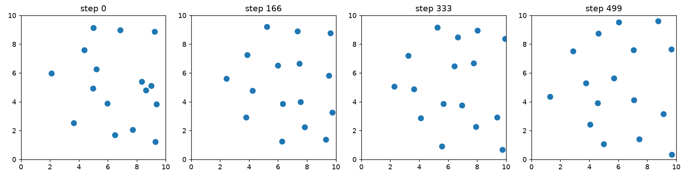

# Atomic Toy Model — Project Submission

A 2D toy model of atoms: 16 particles in a reflecting box, joined by short-range spring-like forces and advanced in time with the velocity-Verlet integrator. The project builds this baseline simulator, then studies how its energy, timestep, precision, speed (Python vs C) and memory behave. Everything is written up in [REPORT.pdf](REPORT.pdf).



Fundamentals of Scientific Computing: Computational Thinking Project
Instructors: Prof. Anuj Goyal and Prof. Saswata Bhattacharyya
Group 8

## Details of members

| Name | Roll Number |
|------|------|
| Ansh Dadhore | CO26BTECH11003 |
| Deepak Kumar Singhadiya | CO26BTECH11005 |
| Purushottam Narayan | MS26BTECH11027 |
| Sajal Bajaj | MS26BTECH11029 |
| Boyanapelli Abhiram Rao | CO26BTECH11004 |

## Presentation video

Status: complete (recorded by all five members). [Watch the videos on Google Drive](https://drive.google.com/drive/folders/1sWaezrVleNV6dEIxUMDgimZArnhEIa13?usp=drive_link).

## Roles and responsibilities

- Ansh — Baseline simulator and verification (Task 1): particle model, wall reflection, forces, velocity-Verlet integration, and the numerical correctness checks
- Deepak — Trajectory animation (Task 2) and numerical precision study (Task 5): float32 vs float64
- Purushottam — Energy and timestep accuracy (Task 3) and memory/scalability analysis (Task 7)
- Sajal — Dissipation and relaxation (Task 4) and the innovation feature (Task 8)
- Abhiram — Computational efficiency and scaling (Task 6) and the final engineering recommendation (Task 9), plus report assembly

## Acknowledgment of AI usage

Claude — for code development and debugging

## Files shared

- README (this file)
- `REPORT.pdf` / `REPORT.docx` / `REPORT.html` — the full project report (Word + PDF): model, all 9 tasks, plots, tables, final recommendation
- `sim.py` — Task 1 baseline simulator (standalone, matches the report's Task 1 numbers)
- `core.py` — shared physics used by every task script, so the model is identical everywhere
- `task2_animation.py` ... `task8_innovation.py` — one script per task, each runs standalone and regenerates its own plot(s)
- `task9_final_recommendation.md` — Task 9 writeup
- `pair_forces.c` / `libpairforces.dylib` — the C implementation used in Task 6 (see the macOS build step below)
- `mindmap.png`, `flowchart.png` — project plan visuals
- `Atomic-Toy-Model-Project-Plan.pptx/.pdf` — project plan slides
- `concepts.md`, `sim.md` — supporting notes

## Quickstart

Requires Python 3.12 or newer (the pinned NumPy needs it). macOS is needed for the prebuilt `.dylib`; everything else also runs on Linux.

```bash
git clone https://github.com/ansh-kun/atomic-toy-model.git
cd atomic-toy-model
python3 -m venv venv           # check `python3 --version` is 3.12 or newer
source venv/bin/activate          # Windows: venv\Scripts\activate
pip install -r requirements.txt   # numpy, matplotlib, pillow, python-docx
python sim.py                     # Task 1 baseline
```

`sim.py` prints the energy drift and the correctness checks (symmetric distances, no self-neighbours, particles inside the box, net force ~ 0).

Other tasks (each regenerates its own plots):

```bash
python task2_animation.py         # ... through task8_innovation.py
```

### Task 6: build the C benchmark (macOS)

`task6_efficiency.py` loads `libpairforces.dylib` from the repo folder. Rebuild it from source with the Xcode command line tools (`xcode-select --install` if `cc` is missing):

```bash
cc -O2 -shared -fPIC -o libpairforces.dylib pair_forces.c
python task6_efficiency.py
```

### Rebuild the report

```bash
python build_report.py            # REPORT.html
python build_docx_report.py       # REPORT.docx (needs python-docx)
soffice --headless --convert-to pdf REPORT.html   # REPORT.pdf
```

The PDF step needs LibreOffice (`brew install --cask libreoffice`) with `soffice` on your PATH.

### Optional: regenerate the plan slides, flowchart and mind map

`build_plan_ppt.py` needs `python-pptx` (`pip install python-pptx`). It is not in `requirements.txt` because the main tasks don't use it. The flowchart and mind map scripts only need the base requirements.
